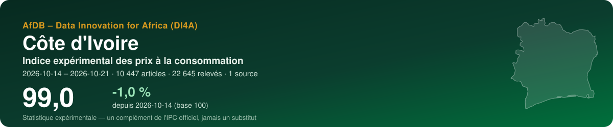
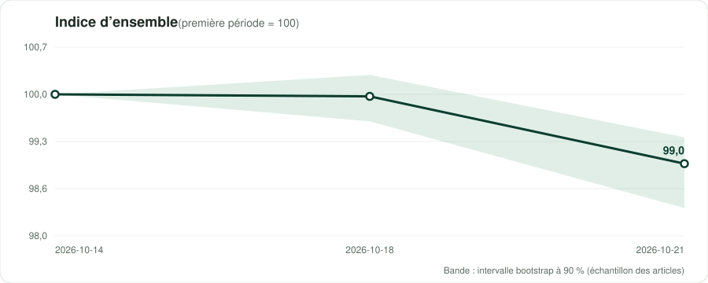
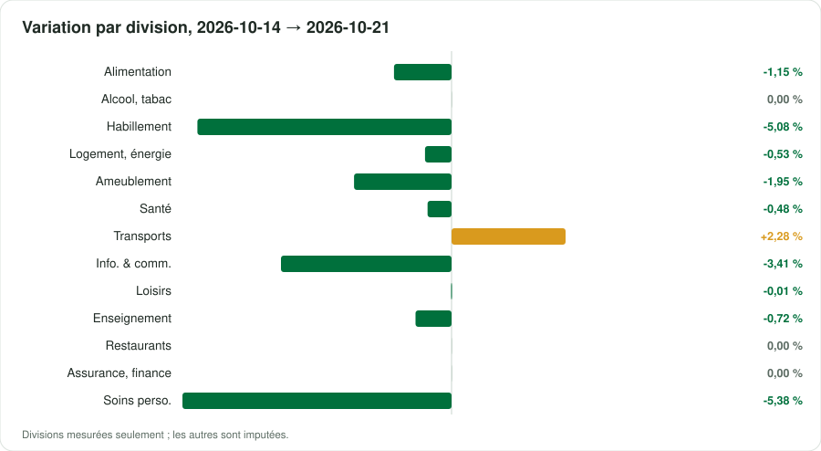
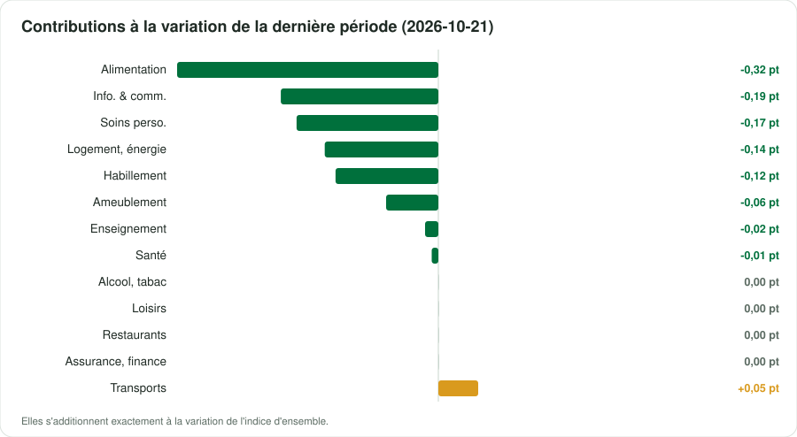

<p align="center"></p>

<p align="center">
  <a href="https://datainnov4africa-web.github.io/cpi-ci/"><b>▶ Ouvrir le tableau de bord</b></a> · <a href="README.md">English version</a>
</p>

<p align="center">
      
</p>

## En bref

| Indicateur | Valeur |
|---|---|
| **Indice d'ensemble** | **99,0** (-1,0 % depuis 2026-10-14) |
| Variation de la dernière période | -0,98 % |
| Fenêtre | 2026-10-14 → 2026-10-21 · par date de collecte |
| Données | 22 645 relevés · 10 447 articles · 1 source |
| Divisions COICOP mesurées | 13 / 13 |
| Pondérations | officielles — Ministère de l'Économie, du Plan et du Développement — IHPC base 2023 = 100, COICOP 2018, publication n°321 (août 2026), tableau 1 |
| Devise | XOF (FCFA) |

> [!WARNING]
> Données de démonstration : les chiffres illustrent la méthode, ce n'est pas une statistique publiée.

> [!IMPORTANT]
> Statistique expérimentale construite à partir de prix publiés en ligne (boutiques, régulateurs, services publics, données de marché). Un complément de l'indice officiel des prix de l'institut national de la statistique — jamais un substitut.

<p align="center"></p>

## Messages clés

| Confiance | Message | Pourquoi |
|---|---|---|
| 🟠 Faible | Entre 2026-10-14 et 2026-10-21, l'indice expérimental a varié de -1,0 % (3 périodes, 10447 articles). | Des dates de collecte dans un seul mois : un mouvement de court terme, pas encore une tendance mensuelle. |
| 🟡 Moyenne | Sur la dernière période, la plus forte contribution vient de la division 01 (Produits alimentaires et boissons non alcoolisées) : -0,32 point de pourcentage. | Les contributions s'additionnent exactement à la variation de l'indice d'ensemble. |
| 🟠 Faible | Les groupes COICOP où au moins un article est suivi pèsent 98 % du panier officiel. | Être atteint n'est pas être représenté : un groupe peut être suivi par quelques articles en ligne éloignés de ses variétés officielles. Les groupes non mesurés sont imputés par ceux qui le sont. |
| 🟢 Élevée | Sur la dernière période, 87% des prix n'ont pas bougé, 11% ont baissé et 1% ont augmenté : le profil d'une campagne de promotion, pas d'un mouvement général des prix. | Les prix en ligne suivent le calendrier commercial ; plusieurs collectes par mois le lissent. |
| 🟢 Élevée | Les promotions comptent pour -1,9 points dans l'indice : aux prix barrés affichés par les vendeurs il serait à 100,9 au lieu de 99,0. | Les prix soldés ouverts à tous sont des prix payés et restent dans l'indice, comme dans la pratique officielle ; l'écart montre la part du calendrier commercial dans le mouvement. Un prix barré est la référence du vendeur, pas un prix vérifié. |
| 🟡 Moyenne | Échantillonnage des articles : le dernier indice se situe entre 98,4 et 99,4 dans 90 % de 100 réplications bootstrap. | L'intervalle couvre le choix des articles collectés, pas le biais des prix en ligne face aux prix en magasin. |
| 🟠 Faible | Classification mesurée sur un échantillon annoté : F1 pondéré 68% au niveau de la division. | Les articles mal classés passent d'une division à l'autre, ils ne sortent pas de l'indice. |

## Par division COICOP

<p align="center"></p>

| | Division | Poids % | Articles | Variation % | Contribution, dernière période (pt) |
|---|---|---:|---:|---:|---:|
| 01 | Produits alimentaires et boissons non alcoolisées | 31,9 | 752 | -1,15 | -0,315 |
| 02 | Boissons alcoolisées, tabac et stupéfiants | 0,8 | 13 | 0,00 | 0,000 |
| 03 | Articles d'habillement et chaussures | 3,5 | 1429 | -5,08 | -0,124 |
| 04 | Logement, eau, électricité, gaz et autres combustibles | 15,5 | 287 | -0,53 | -0,137 |
| 05 | Meubles, équipements ménagers et entretien courant | 3,4 | 2883 | -1,95 | -0,063 |
| 06 | Santé | 4,7 | 264 | -0,48 | -0,008 |
| 07 | Transports | 10,0 | 187 | +2,28 | +0,048 |
| 08 | Information et communication | 8,8 | 2305 | -3,41 | -0,190 |
| 09 | Loisirs, sports et culture | 2,0 | 310 | -0,01 | 0,000 |
| 10 | Services d'enseignement | 2,5 | 22 | -0,72 | -0,016 |
| 11 | Restaurants et services d'hébergement | 13,3 | 11 | 0,00 | 0,000 |
| 12 | Assurances et services financiers | 0,2 | 7 | 0,00 | 0,000 |
| 13 | Soins personnels, protection sociale et divers | 3,3 | 1977 | -5,38 | -0,171 |

*Imputée* : aucun prix lu pour la division ; elle évolue comme les divisions mesurées (Manuel de l'IPC 2020, ch. 6).

<p align="center"></p>

## Sources

15 sources actives au registre, 7 exclues avec leur motif. Chaque requête du robot lit d'abord le robots.txt ; un refus est consigné, jamais contourné.

| Source | Type | COICOP | Statut | Relevés de cette exécution |
|---|---|---|---|---:|
| [Jumia Côte d'Ivoire](https://www.jumia.ci) | boutique en ligne | 01, 03, 05, 06, 08, 09, 13 | vérifiée | 22 645 |
| [Glovo Abidjan (supermarkets, restaurants, parapharmacies)](https://glovoapp.com/fr/ci/abidjan-nord/) | boutique en ligne | 01, 02, 11, 13 | partielle | 0 |
| [OCPV — weekly consumer prices on markets](https://www.economie-ivoirienne.ci/info-prix.html) | prix de marché | 01 | vérifiée | 0 |
| [ANARE-CI — electricity tariff grid](https://anare.ci/le-marche/prix-de-lelectricite/) | tarif réglementé | 04 | vérifiée | 0 |
| [Maximum retail prices of petroleum products (monthly order)](https://www.koaci.com/article/2026/09/30/cote-divoire/economie/cote-divoire-les-prix-maxima-de-detail-des-produits-petroliers-sont-maintenus-inchanges-pour-la-periode-du-1er-au-31-octobre-2026_201133.html) | tarif réglementé | 07, 04 | vérifiée | 0 |
| [MTN Côte d'Ivoire — mobile data bundles](https://www.mtn.ci/deal/offre-internet-mobile/) | tarif réglementé | 08 | vérifiée | 0 |
| [CoinAfrique Côte d'Ivoire — rental listings](https://ci.coinafrique.com/categorie/appartements) | loyers | 04 | partielle | 0 |
| [Wave — mobile money fees](https://www.wave.com/fr/) | tarif réglementé | 12 | partielle | 0 |
| [Public higher-education registration fees](https://erooamba.com/posts/frais-scolarite-universites-ecoles-cote-ivoire-2026-2027) | tarif réglementé | 10 | partielle | 0 |
| [GlobalPetrolPrices — fuel cross-check](https://www.globalpetrolprices.com/Ivory-Coast/gasoline_prices/) | référence officielle | 07 | partielle | 0 |
| [World Bank — official CPI (annual)](https://api.worldbank.org/v2/country/CIV/indicator/FP.CPI.TOTL) | référence officielle | — | vérifiée | 0 |
| [IMF DataMapper — inflation (WEO)](https://www.imf.org/external/datamapper/api/v1/PCPIPCH/CIV) | référence officielle | — | vérifiée | 0 |
| [Orange Money Côte d'Ivoire — fees](https://www.orange.ci/fr/tarifs-orange-money.html) | tarif réglementé | 12 | vérifiée | 0 |
| [Official school fees — baccalauréat and secondary registration](https://servicepublic.gouv.ci/accueil/detaildemarcheparticulier/1/391/142) | tarif réglementé | 10 | partielle | 0 |
| [Pharmacie Ivoirienne — online pharmacy (over-the-counter medicines)](https://pharmacie-ivoirienne.com/produits/upsa-efferalgan/) | boutique en ligne | 06 | partielle | 0 |

<details><summary>7 sources exclues et pourquoi</summary>

- **ANStat / ins.ci** — Le robots.txt d'ins.ci refuse les clients automatisés ; anstat.ci a répondu une erreur client. L'IHPC mensuel n'est disponible que par la presse.
- **WFP market prices (HDX)** — Périmé : dernière mise à jour le 9 décembre 2018, données du 15/01/2005 au 15/10/2018 (revérifié le 28/10/2026, inchangé).
- **SOTRA bus fares** — Site en maintenance le 21/10/2026 ; tarifs seulement dans la presse. Le 28/10/2026, la seule grille 2026 trouvée (300 standard / 500 express) vient d'un blog promotionnel sans source officielle ni date d'effet : sous le seuil.
- **CIE** — Le robots.txt refuse les clients automatisés — l'ANARE-CI publie la même grille.
- **Yango (rides, Deli)** — Prix uniquement dans l'application mobile.
- **Orange Côte d'Ivoire — mobile internet passes** — Lu le 28/10/2026 : la page liste des pass avec volume et validité (ex. Pass Mois Lite 2,5 Go / 30 jours) mais aucun prix en FCFA dans le texte servi. MTN porte la division 08.
- **Jumia — beer, wine and spirits** — Redirige vers une page de validation d'âge interdite par le robots.txt (Disallow: /sp-*/*/). L'alcool est lu sur les pages supermarchés de Glovo à la place.

</details>

## Méthode

Articles appariés ; indices élémentaires de **Jevons** par classe COICOP 2018, points de vente en strates de poids égal ; imputation explicite des prix manquants (deux périodes au plus, onze pour les produits saisonniers) ; remplacements raccordés avec ajustement de quantité ; agrégation avec les poids officiels sous forme **Young/Lowe**, chaînée ; GEKS pour contrôler la dérive de chaînage ; intervalle bootstrap à 90 %. Comme le prescrit le *Manuel de l'indice des prix à la consommation* (FMI et al., 2020). Détails : [docs/METHODOLOGIE.md](docs/METHODOLOGIE.md).

## Données

Copies ouvertes, lisibles par machine, de ce que montre le tableau de bord :

- [`data/index_all_items.csv`](data/index_all_items.csv) — indice d'ensemble par période, avec son intervalle à 90 %
- [`data/index_divisions.csv`](data/index_divisions.csv) — indice de chaque division mesurée
- [`data/contributions.csv`](data/contributions.csv) — contributions des divisions à chaque variation, en points
- [`data/basket.csv`](data/basket.csv) — poids, articles et variation par division
- [`data/sources.csv`](data/sources.csv) — le registre des sources et ce que l'exécution a obtenu de chacune
- [`data/metadata.json`](data/metadata.json) — pays, périodes, pondérations et chiffres clés

## Reproduire

L'indice est produit par la boîte à outils ouverte **cpi-di4a** en deux notebooks : le notebook 1 collecte poliment les prix (robots.txt d'abord, robot identifié) et les scelle dans une archive ; le notebook 2 classe, calcule et publie ce dépôt. Choisissez le code pays, *Exécution → Tout exécuter*.

## Citer

```text
AfDB – Data Innovation for Africa (DI4A) (2026). Indice expérimental des prix à la consommation — Côte d'Ivoire. https://datainnov4africa-web.github.io/cpi-ci/
```

Voir aussi [CITATION.cff](CITATION.cff).

---

<p align="center"><sub>AfDB – Data Innovation for Africa (DI4A) · généré le 2026-10-28 · code sous licence MIT ; les données collectées restent soumises aux conditions de chaque source</sub></p>
