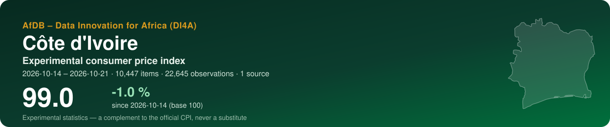
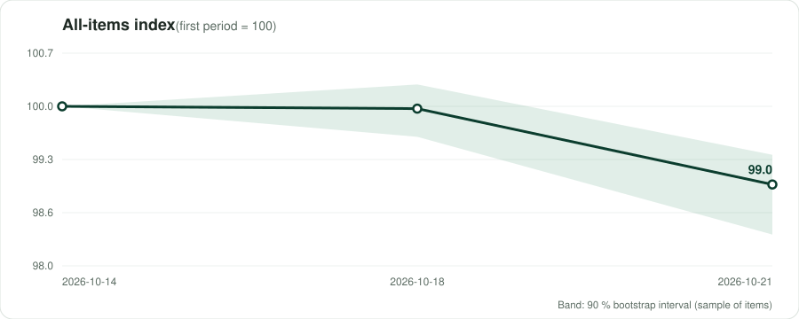
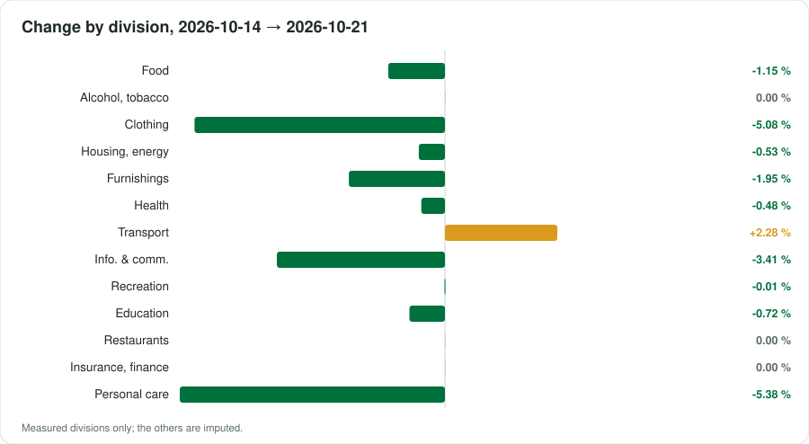
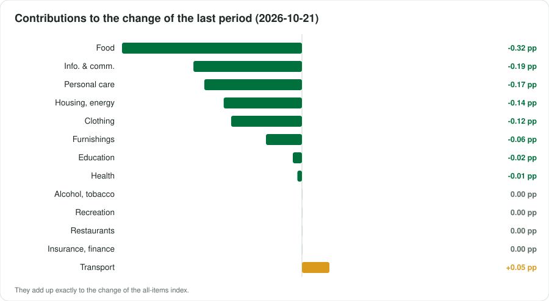

<p align="center"></p>

<p align="center">
  <a href="https://datainnov4africa-web.github.io/cpi-ci/"><b>▶ Open the live dashboard</b></a> · <a href="README.fr.md">Version française</a>
</p>

<p align="center">
      
</p>

## At a glance

| Indicator | Value |
|---|---|
| **All-items index** | **99.0** (-1.0 % since 2026-10-14) |
| Last period change | -0.98 % |
| Window | 2026-10-14 → 2026-10-21 · by collection date |
| Data | 22,645 observations · 10,447 items · 1 source |
| COICOP divisions measured | 13 / 13 |
| Weights | official — Ministère de l'Économie, du Plan et du Développement — IHPC base 2023 = 100, COICOP 2018, publication n°321 (août 2026), tableau 1 |
| Currency | XOF (FCFA) |

> [!WARNING]
> Demonstration data: the figures illustrate the method, they are not a published statistic.

> [!IMPORTANT]
> Experimental statistics built from prices published online (shops, regulators, utilities, market data). A complement to the official consumer price index of the national statistics office — never a substitute.

<p align="center"></p>

## Key messages

| Confidence | Message | Why |
|---|---|---|
| 🟠 Low | Between 2026-10-14 and 2026-10-21, the experimental index moved by -1.0 % (3 periods, 10447 items). | Collection dates within a single month: a short-term movement, not yet a monthly trend. |
| 🟡 Medium | Over the last period, the largest contribution comes from division 01 (Food and non-alcoholic beverages): -0.32 percentage point. | Contributions add up exactly to the change of the all-items index. |
| 🟠 Low | The COICOP groups in which at least one item is followed weigh 98 % of the official basket. | Being reached is not being represented: a group can be followed through a few online items far from its official varieties. Unmeasured groups are imputed by the measured ones. |
| 🟢 High | Over the last period, 87% of prices did not move, 11% fell and 1% rose: the pattern of a promotion campaign, not of general price movement. | Online prices react to commercial calendars; several collections per month smooth this out. |
| 🟢 High | Promotions account for -1.9 points of the index: at the struck-through prices shown by the shops it would stand at 100.9 instead of 99.0. | Sale prices open to every buyer are prices paid and stay in the index, as in official practice; the gap shows how much of the movement is commercial calendar. A struck-through price is the shop's own reference, not a verified price. |
| 🟡 Medium | Sampling of items: the latest index lies between 98.4 and 99.4 in 90 % of 100 bootstrap replications. | The interval covers which items were collected, not the bias of online prices against shop prices. |
| 🟠 Low | Classification measured on an annotated sample: weighted F1 68% at division level. | Misclassified items move between divisions, not out of the index. |

## By COICOP division

<p align="center"></p>

| | Division | Weight % | Items | Change % | Contribution, last period (pp) |
|---|---|---:|---:|---:|---:|
| 01 | Food and non-alcoholic beverages | 31.9 | 752 | -1.15 | -0.315 |
| 02 | Alcoholic beverages, tobacco and narcotics | 0.8 | 13 | 0.00 | 0.000 |
| 03 | Clothing and footwear | 3.5 | 1429 | -5.08 | -0.124 |
| 04 | Housing, water, electricity, gas and other fuels | 15.5 | 287 | -0.53 | -0.137 |
| 05 | Furnishings, household equipment and maintenance | 3.4 | 2883 | -1.95 | -0.063 |
| 06 | Health | 4.7 | 264 | -0.48 | -0.008 |
| 07 | Transport | 10.0 | 187 | +2.28 | +0.048 |
| 08 | Information and communication | 8.8 | 2305 | -3.41 | -0.190 |
| 09 | Recreation, sport and culture | 2.0 | 310 | -0.01 | 0.000 |
| 10 | Education services | 2.5 | 22 | -0.72 | -0.016 |
| 11 | Restaurants and accommodation services | 13.3 | 11 | 0.00 | 0.000 |
| 12 | Insurance and financial services | 0.2 | 7 | 0.00 | 0.000 |
| 13 | Personal care, social protection and miscellaneous | 3.3 | 1977 | -5.38 | -0.171 |

*Imputed*: no price was read for the division; it moves with the measured ones (CPI Manual 2020, ch. 6).

<p align="center"></p>

## Sources

15 active sources in the register, 7 excluded with their reason. Every robot request reads robots.txt first; a refusal is recorded, never circumvented.

| Source | Type | COICOP | Status | Observations this run |
|---|---|---|---|---:|
| [Jumia Côte d'Ivoire](https://www.jumia.ci) | online shop | 01, 03, 05, 06, 08, 09, 13 | verified | 22,645 |
| [Glovo Abidjan (supermarkets, restaurants, parapharmacies)](https://glovoapp.com/fr/ci/abidjan-nord/) | online shop | 01, 02, 11, 13 | partial | 0 |
| [OCPV — weekly consumer prices on markets](https://www.economie-ivoirienne.ci/info-prix.html) | market prices | 01 | verified | 0 |
| [ANARE-CI — electricity tariff grid](https://anare.ci/le-marche/prix-de-lelectricite/) | regulated tariff | 04 | verified | 0 |
| [Maximum retail prices of petroleum products (monthly order)](https://www.koaci.com/article/2026/09/30/cote-divoire/economie/cote-divoire-les-prix-maxima-de-detail-des-produits-petroliers-sont-maintenus-inchanges-pour-la-periode-du-1er-au-31-octobre-2026_201133.html) | regulated tariff | 07, 04 | verified | 0 |
| [MTN Côte d'Ivoire — mobile data bundles](https://www.mtn.ci/deal/offre-internet-mobile/) | regulated tariff | 08 | verified | 0 |
| [CoinAfrique Côte d'Ivoire — rental listings](https://ci.coinafrique.com/categorie/appartements) | rents | 04 | partial | 0 |
| [Wave — mobile money fees](https://www.wave.com/fr/) | regulated tariff | 12 | partial | 0 |
| [Public higher-education registration fees](https://erooamba.com/posts/frais-scolarite-universites-ecoles-cote-ivoire-2026-2027) | regulated tariff | 10 | partial | 0 |
| [GlobalPetrolPrices — fuel cross-check](https://www.globalpetrolprices.com/Ivory-Coast/gasoline_prices/) | official benchmark | 07 | partial | 0 |
| [World Bank — official CPI (annual)](https://api.worldbank.org/v2/country/CIV/indicator/FP.CPI.TOTL) | official benchmark | — | verified | 0 |
| [IMF DataMapper — inflation (WEO)](https://www.imf.org/external/datamapper/api/v1/PCPIPCH/CIV) | official benchmark | — | verified | 0 |
| [Orange Money Côte d'Ivoire — fees](https://www.orange.ci/fr/tarifs-orange-money.html) | regulated tariff | 12 | verified | 0 |
| [Official school fees — baccalauréat and secondary registration](https://servicepublic.gouv.ci/accueil/detaildemarcheparticulier/1/391/142) | regulated tariff | 10 | partial | 0 |
| [Pharmacie Ivoirienne — online pharmacy (over-the-counter medicines)](https://pharmacie-ivoirienne.com/produits/upsa-efferalgan/) | online shop | 06 | partial | 0 |

<details><summary>7 excluded sources and why</summary>

- **ANStat / ins.ci** — ins.ci robots.txt refuses automated clients; anstat.ci answered a client error. The monthly IHPC is available through the press only.
- **WFP market prices (HDX)** — Stale: last modified 9 Dec 2018, data 15 Jan 2005 – 15 Oct 2018 (re-checked 2026-10-28, unchanged).
- **SOTRA bus fares** — Site in maintenance on 2026-10-21; fares only in the press. On 2026-10-28 the only 2026 fare list found (300 standard / 500 express) is an app-promotion blog with no official source and no effective date: below the bar.
- **CIE** — robots.txt refuses automated clients — ANARE-CI publishes the same grid.
- **Yango (rides, Deli)** — Prices only in the mobile app.
- **Orange Côte d'Ivoire — mobile internet passes** — Read 2026-10-28: the page lists passes with volume and validity (e.g. Pass Mois Lite 2.5 GB / 30 days) but no FCFA price in the served text. MTN carries division 08.
- **Jumia — beer, wine and spirits** — Redirects to an age-validation page that robots.txt forbids (Disallow: /sp-*/*/). Alcohol is read from the Glovo supermarket pages instead.

</details>

## Method

Matched items; elementary **Jevons** indices by COICOP 2018 class, outlets as equal-weight strata; explicit imputation of missing prices (two periods at most, eleven for seasonal items); replacements linked with a quantity adjustment; aggregation with official weights in the **Young/Lowe** form, chained; GEKS as a chain-drift check; a 90 % bootstrap interval. As prescribed by the *Consumer Price Index Manual: Concepts and Methods* (IMF et al., 2020). Details: [docs/METHODOLOGY.md](docs/METHODOLOGY.md).

## Data

Open, machine-readable copies of what the dashboard shows:

- [`data/index_all_items.csv`](data/index_all_items.csv) — all-items index by period, with its 90 % interval
- [`data/index_divisions.csv`](data/index_divisions.csv) — index of each measured division
- [`data/contributions.csv`](data/contributions.csv) — contributions of the divisions to each change, in percentage points
- [`data/basket.csv`](data/basket.csv) — weights, items and change by division
- [`data/sources.csv`](data/sources.csv) — the source register and what this run obtained from each source
- [`data/metadata.json`](data/metadata.json) — country, periods, weights and key figures

## Reproduce

The index is produced by the open toolkit **cpi-di4a** in two notebooks: notebook 1 collects prices politely (robots.txt first, identified robot) and seals them in an archive; notebook 2 classifies, computes and publishes this repository. Set the country code, *Runtime → Run all*.

## Cite

```text
AfDB – Data Innovation for Africa (DI4A) (2026). Experimental consumer price index — Côte d'Ivoire. https://datainnov4africa-web.github.io/cpi-ci/
```

See also [CITATION.cff](CITATION.cff).

---

<p align="center"><sub>AfDB – Data Innovation for Africa (DI4A) · generated on 2026-10-28 · code under MIT licence; collected data remain subject to each source's terms</sub></p>
